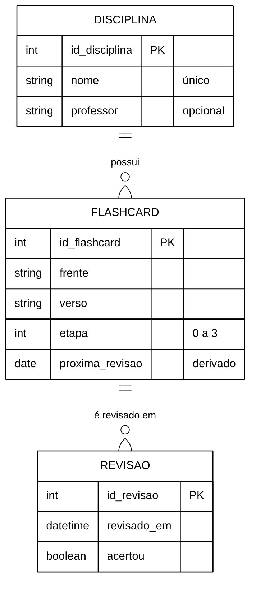
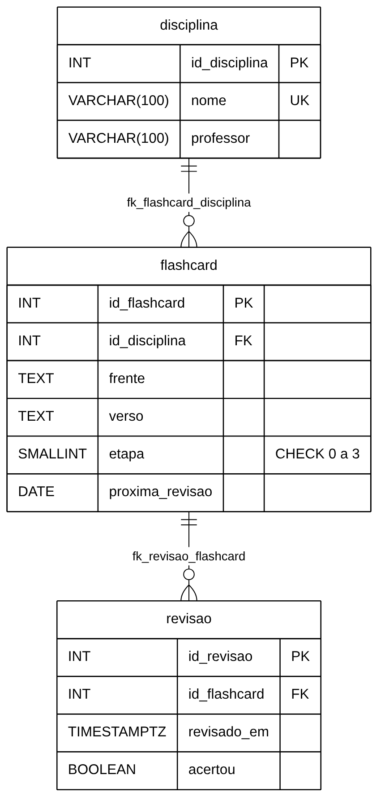

# Cadência — Documentação do projeto

Projeto Integrador de Sistemas Computacionais · Unieuro · ADS, 4º semestre · Prof. Henrique Dominges Garcia

Integrantes: Caio Andrax Portela Carvalho e Guilherme Pinheiro

> O que já está implementado em cada requisito aparece na tabela de situação do [README](../README.md).
> A especificação completa (casos de uso, regras de negócio e telas) está no [Documento de Requisitos](REQUISITOS.md).

---

## 1. Introdução

### 1.1 Contexto e origem

O Cadência nasceu no Projeto Integrador do 4º semestre de Análise e Desenvolvimento de Sistemas da Unieuro, a partir de um documento de requisitos que previa uma plataforma web. Nesta etapa, o escopo foi revisado e reduzido para um aplicativo de terminal em Java com banco de dados PostgreSQL.

### 1.2 Demandante e problema

O demandante é o estudante de graduação noturna, que trabalha durante o dia, assiste cerca de 15 horas de aula por semana e não tem tempo nem método para revisar. Sem revisão, o conteúdo só é estudado na véspera da prova, com baixa retenção. Os usuários diretos são os próprios alunos da turma.

### 1.3 Proposta e escopo desta entrega

Um sistema de terminal para cadastrar disciplinas e flashcards e revisá-los em intervalos fixos de 1, 3, 7 e 15 dias. Esta entrega cobre menus de navegação, persistência no banco e testes. Interface web, login e o algoritmo SM-2 ficam fora do escopo.

---

## 2. Objetivos

### 2.1 Objetivo Geral

Desenvolver a primeira versão funcional de um sistema de linha de comando em Java, com persistência em banco de dados relacional PostgreSQL, para cadastro de disciplinas e flashcards e agendamento de revisões em intervalos fixos de 1, 3, 7 e 15 dias, a fim de ajudar estudantes de graduação noturna a revisar o conteúdo das aulas com pouco tempo disponível.

### 2.2 Objetivos Específicos

1. **Modelagem (entrada):** traduzir os requisitos em modelos conceitual, lógico e físico de banco de dados, normalizados até a 3FN, e em um mapa de navegação dos menus do terminal.
2. **Persistência (construção):** implementar o script SQL DDL e a camada DAO, com acesso ao PostgreSQL via JDBC, para gravar e consultar disciplinas, flashcards e revisões.
3. **Fluxo e regras (construção):** implementar os menus de terminal e as regras de negócio, separados nas camadas view, service e dao, com validação das entradas do usuário e cálculo da data da próxima revisão.
4. **Testes (verificação):** executar testes unitários e de integração com JUnit, para detectar falhas nas regras de revisão e na comunicação com o banco.
5. **Validação:** confrontar o sistema com a necessidade real do demandante, pedindo a colegas de turma que o usem e conferindo os critérios de aceitação das histórias de usuário.

---

## 3. Requisitos

### 3.1 Requisitos Funcionais

| ID | Requisito | Descrição |
|---|---|---|
| RF-01 | Cadastro de disciplinas | Permite cadastrar disciplinas com nome (obrigatório e único) e professor (opcional). |
| RF-02 | Cadastro de flashcards | Permite cadastrar flashcards vinculados a uma disciplina, com frente e verso obrigatórios. O card novo começa na etapa 0, com a primeira revisão no dia seguinte. |
| RF-03 | Listagem | Lista as disciplinas e os flashcards de uma disciplina, com mensagem clara quando não houver registros. |
| RF-04 | Revisão do dia | Apresenta os flashcards com revisão prevista para hoje ou antes: mostra a frente, revela o verso quando o aluno pedir e pergunta se acertou. |
| RF-05 | Agendamento por intervalos fixos | Etapa 0 = 1 dia, etapa 1 = 3 dias, etapa 2 = 7 dias, etapa 3 = 15 dias. Acerto avança uma etapa (a etapa 3 permanece); erro volta à etapa 0. |
| RF-06 | Histórico de revisões | Registra cada resposta (data e se acertou) e permite consultar o histórico de um flashcard. |
| RF-07 | Remoção com confirmação | Remove disciplinas e flashcards após confirmação (S/N). Apagar uma disciplina apaga os seus flashcards. |

### 3.2 Requisitos Não Funcionais

| ID | Requisito | Descrição |
|---|---|---|
| RNF-01 | Paradigma | Java orientado a objetos, em camadas view/service/dao/model. As regras de negócio ficam no service, sem depender da tela nem do banco. |
| RNF-02 | Ambiente | Executa no terminal e compila com `javac`, sem framework. |
| RNF-03 | Banco de dados | PostgreSQL via JDBC. DDL com PK, FK, UNIQUE, CHECK e CREATE INDEX. Modelo normalizado até a 3FN. |
| RNF-04 | Robustez | Entradas inválidas não encerram o programa: o sistema mostra uma mensagem clara e pede de novo. |
| RNF-05 | Execução local | O banco roda na máquina do usuário, sem internet nem APIs externas. |
| RNF-06 | Disponibilidade sem banco | Se o PostgreSQL não estiver acessível, o sistema avisa e funciona com os dados em memória. |
| RNF-07 | Segurança da configuração | A senha do banco é informada por variável de ambiente e nunca fica no código-fonte. |
| RNF-08 | Usabilidade | Menus numerados, mensagens com [OK] e [ERRO], tabelas alinhadas e datas no formato dd/mm/aaaa. |

---

## 4. Histórias de usuário

### US-01 — Cadastro de flashcards

> Como estudante de graduação noturna, eu quero cadastrar flashcards em uma disciplina, para que eu possa transformar o conteúdo da aula em cartões de revisão.

Critérios de aceitação:

- O menu "Cadastrar flashcard" pede uma disciplina existente; se não houver disciplinas, exibe "Cadastre uma disciplina primeiro".
- Frente e verso são obrigatórios (se vazio, mostra mensagem e pede de novo).
- Ao salvar: etapa 0, primeira revisão no dia seguinte e a mensagem "[OK] Flashcard cadastrado".

### US-02 — Revisão do dia

> Como estudante de graduação noturna, eu quero revisar apenas os flashcards que vencem hoje, para que eu use meu pouco tempo livre no que realmente precisa ser revisado.

Critérios de aceitação:

- A opção "Revisar hoje" mostra um card por vez (a frente; o verso só quando o aluno pedir).
- O sistema pergunta se o aluno acertou (S/N). Acerto avança a etapa e agenda a próxima revisão em 1, 3, 7 ou 15 dias; erro volta à etapa 0.
- Sem cards vencidos, exibe "Nenhum flashcard para revisar hoje".

### US-03 — Histórico de revisões

> Como estudante de graduação noturna, eu quero consultar o histórico de revisões de um flashcard, para que eu identifique os conteúdos em que mais erro.

Critérios de aceitação:

- A opção "Ver histórico" aparece depois de escolher um flashcard.
- O histórico mostra colunas alinhadas com a data e se acertou, da revisão mais recente para a mais antiga.
- Sem revisões, exibe "Este flashcard ainda não foi revisado".

---

## 5. Modelagem de dados

A modelagem segue três níveis: conceitual (o problema, sem detalhes de banco), lógico (as tabelas) e físico (o script SQL). Os diagramas são gerados a partir dos arquivos `.mmd` da pasta `docs/diagramas`.

### 5.1 Modelo conceitual (DER)

Entidades:

- **DISCIPLINA:** a matéria cadastrada pelo aluno. O nome é único e o professor é opcional.
- **FLASHCARD:** o cartão de estudo, com frente (pergunta) e verso (resposta). Guarda a etapa (0 a 3) e a data da próxima revisão.
- **REVISAO:** cada vez que o aluno estuda um cartão, com a data e hora e se acertou.

Relacionamentos:

- Uma disciplina possui zero ou mais flashcards; cada flashcard pertence a exatamente uma disciplina (1:N).
- Um flashcard é revisado zero ou mais vezes; cada revisão é de exatamente um flashcard (1:N).

`proxima_revisao` é um atributo derivado: pode ser calculado a partir da etapa e da data da última revisão. Ele é armazenado para que a busca dos cartões do dia seja uma consulta simples (ver `DECISOES.md`, 09/11).

### 5.2 Modelo lógico

Cada relacionamento 1:N virou uma chave estrangeira no lado N: `flashcard.id_disciplina` referencia `disciplina`, e `revisao.id_flashcard` referencia `flashcard`. As duas usam `ON DELETE CASCADE`: apagar uma disciplina apaga os seus flashcards, e apagar um flashcard apaga as suas revisões.

### 5.3 Modelo físico

O script `sql/schema.sql` cria as tabelas no PostgreSQL 16 com chave primária, chave estrangeira, `UNIQUE`, `CHECK` e índices.

### 5.4 Normalização

- **1FN:** todos os atributos são atômicos. Não há listas dentro de uma coluna: as revisões ficam em tabela própria, uma por linha.
- **2FN:** cada tabela tem chave primária de uma coluna só, então nenhum atributo depende de parte da chave.
- **3FN:** nenhum atributo comum depende de outro atributo comum da mesma tabela. `proxima_revisao` não é determinada só pela `etapa` (dois cartões na mesma etapa podem ter datas diferentes); ela depende também da data da última revisão, que está em outra tabela. A redundância em relação ao histórico é intencional e está registrada em `DECISOES.md`.
