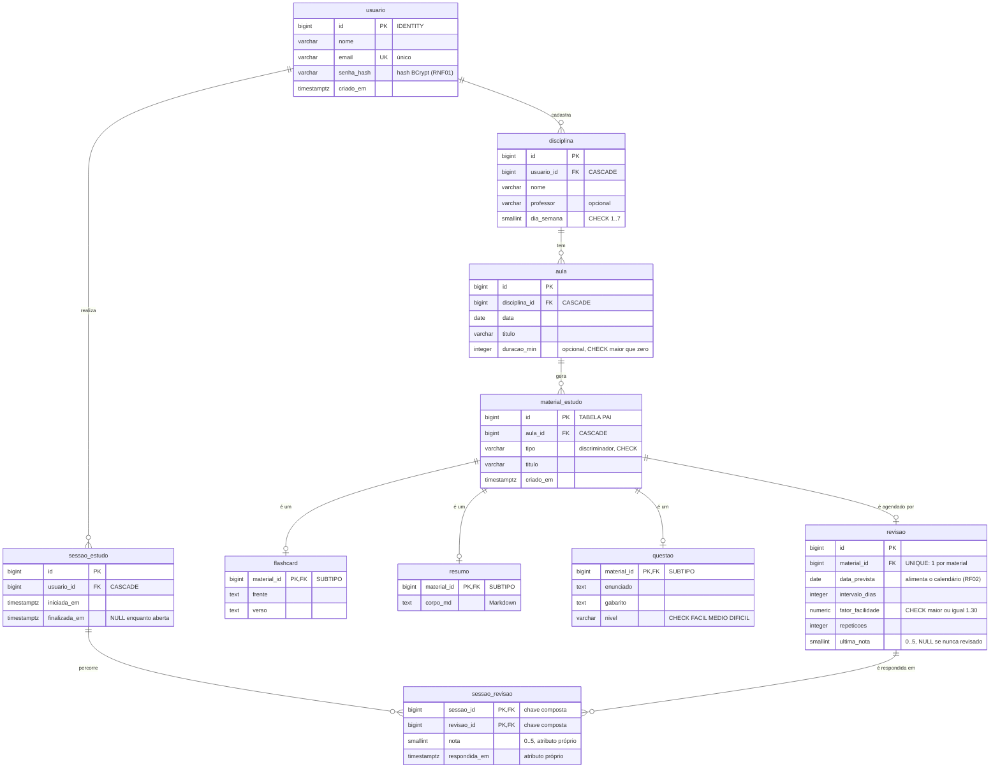

# Modelo Entidade-Relacionamento — Cadência

> Representação visual de `db/migration/V1__esquema_inicial.sql`.
> Fonte dos requisitos: `docs/CHARTER.md` §9. Decisões: `docs/DECISOES.md`.

**DER, não UML.** Este diagrama mostra **tabelas** — é a representação do banco.
O diagrama de classes UML, que mostra as **classes Java**, é outro documento e
será gerado no Sprint 1, a partir do código real. Os dois não coincidem de
propósito: `MaterialEstudo` é *uma* classe abstrata no UML e vira *quatro*
tabelas aqui. Essa diferença é o descasamento objeto-tabela (Sprint 2).

---

## Diagrama completo



---

## Como ler as cardinalidades

- `||--o{` → um para **zero ou muitos**: um usuário pode ter nenhuma ou várias
  disciplinas.
- `||--o|` → um para **zero ou um**: um material tem no máximo uma revisão, e pode
  não ter nenhuma se nunca foi estudado.

Lendo da esquerda para a direita: o lado `||` é o "um", e o que vem depois do `--`
descreve o outro lado. O `o` significa "zero é permitido"; a chave `{` significa
"muitos".

---

## Os três tipos de relacionamento presentes

O modelo foi desenhado para exibir os três casos que a disciplina cobra.

### 1:N — a cadeia de propriedade

```
usuario ──< disciplina ──< aula ──< material_estudo
```

Cada nível pertence a exatamente um pai, e o pai pode ter vários filhos. É uma
relação de **composição**: uma aula não existe fora de uma disciplina. Por isso
toda a cadeia usa `ON DELETE CASCADE`.

### Herança — `material_estudo` e seus três subtipos

```
              material_estudo          (id, aula_id, tipo, titulo, criado_em)
                     │
      ┌──────────────┼──────────────┐
      │              │              │
  flashcard       resumo        questao
 (frente,        (corpo_md)   (enunciado,
  verso)                       gabarito,
                               nivel)
```

Banco relacional não tem herança. A estratégia **Joined Table** resolve assim: o
pai guarda o que é comum, cada filho guarda o que é próprio, e a ligação é uma
coluna que é **PK e FK ao mesmo tempo** (`material_id`).

Essa coluna dupla faz três garantias de uma vez:

1. **PK** → no máximo uma linha de `flashcard` por material
2. **FK** → nenhum `flashcard` órfão, sem material correspondente
3. **NOT NULL real** → `frente` é obrigatória, porque a tabela `flashcard` só
   contém flashcards. Numa tabela única, `frente` teria que aceitar `NULL`, já
   que um resumo não tem frente — e o banco perderia a capacidade de exigir.

A contrapartida: ler um flashcard completo exige `JOIN` entre as duas tabelas.

### N:N com atributos próprios — sessões e revisões

```
sessao_estudo ──< sessao_revisao >── revisao
                   nota
                   respondida_em
```

Uma sessão percorre várias revisões; uma revisão reaparece em várias sessões ao
longo do semestre. A tabela do meio **não serve só para ligar**: ela guarda o que
aconteceu naquele encontro específico.

É por isso que `nota` mora aqui e não em `revisao` — a nota pertence ao *encontro*,
não ao material. Se ela ficasse em `revisao`, cada resposta apagaria a anterior e
o histórico se perderia.

A chave primária é **composta** por `(sessao_id, revisao_id)`: a identidade da
linha são as duas colunas juntas. Efeito colateral útil — a mesma revisão não
pode ser respondida duas vezes dentro da mesma sessão.

---

## Rastreabilidade: onde cada requisito aparece no modelo

| Requisito | Onde |
|---|---|
| RF01 — agendamento SM-2 | `revisao.intervalo_dias`, `fator_facilidade`, `repeticoes` |
| RF02 — calendário de revisões | `revisao.data_prevista` |
| RF03/RF04 — conta e isolamento | `usuario`, e `usuario_id` na raiz de cada cadeia |
| RF05 — disciplinas | `disciplina` |
| RF06 — aulas | `aula` |
| RF07 — calendário semanal/mensal | `aula.data` + `disciplina.dia_semana` |
| RF08 — três tipos de material | `material_estudo` + `flashcard`/`resumo`/`questao` |
| RF10 — fila priorizada | `revisao.data_prevista` + `fator_facilidade` |
| RF11 — progresso por disciplina | `sessao_revisao.nota` agregada pela cadeia até `disciplina` |
| RF12 — sequência de dias | `sessao_estudo.iniciada_em` |
| RNF01 — senha com hash | `usuario.senha_hash` |
| RF13/RF14 — tokens (Fase 2) | *ainda não modelado* |
