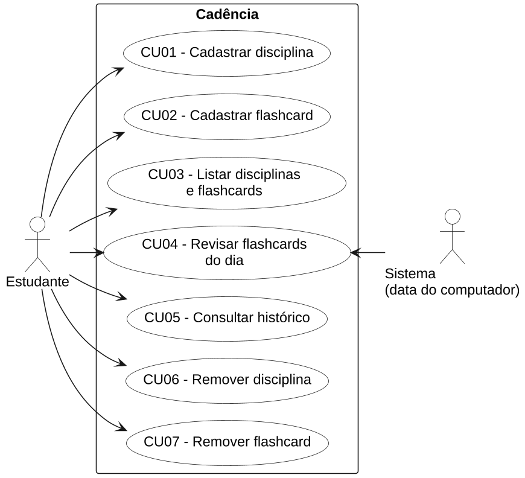

<div class="capa">

<p class="capa-instituicao">Centro Universitário Euro-Americano</p>

<p class="capa-rotulo">Curso</p>
<p>Análise e Desenvolvimento de Sistemas</p>

<p class="capa-rotulo">Disciplina</p>
<p>Projeto Integrador de Sistemas Computacionais</p>

<p class="capa-titulo">Cadência — Sistema de Estudo por Repetição Espaçada</p>

<p>Professor Henrique Dominges Garcia</p>

<p class="capa-rotulo">Alunos</p>
<p>Caio Andrax Portela Carvalho - Guilherme Pinheiro</p>

<p class="capa-local">Brasília - Distrito Federal - 2026</p>

</div>

**Documento de Requisitos**

## 1. Introdução

O presente documento tem como finalidade especificar os requisitos para o desenvolvimento do Cadência, um sistema de terminal destinado ao estudo ativo por repetição espaçada, criado no Projeto Integrador de Sistemas Computacionais do 4º semestre de Análise e Desenvolvimento de Sistemas da Unieuro.

O sistema será utilizado por estudantes de graduação para cadastrar as disciplinas que cursam e os flashcards de cada uma delas. Um flashcard é um cartão de estudo com uma pergunta na frente e a resposta no verso. A cada dia, o sistema apresenta apenas os cartões que precisam ser revisados, registra se o estudante acertou ou errou e agenda automaticamente a próxima revisão.

O projeto surge da dificuldade do estudante do período noturno, que trabalha durante o dia, em manter uma rotina de revisão. Sem método, o conteúdo costuma ser estudado apenas na véspera da prova, o que resulta em baixa retenção e em retrabalho a cada avaliação.

Diante desse cenário, o objetivo principal do sistema é organizar a revisão em intervalos crescentes. Quando o estudante acerta um cartão, ele volta a aparecer depois de mais tempo (1, 3, 7 e 15 dias). Quando erra, o cartão volta no dia seguinte. Assim, o pouco tempo disponível é usado no conteúdo que o estudante ainda não domina. Cada resposta fica registrada em um histórico, que pode ser consultado a qualquer momento.

Os dados são armazenados em um banco de dados relacional PostgreSQL, acessado pela aplicação Java por meio de JDBC. Quando o banco não está disponível, o sistema avisa o usuário e continua funcionando com os dados em memória. O sistema roda localmente, na máquina do estudante, sem internet e sem login.

O Cadência nasceu a partir de um documento de requisitos que previa uma plataforma web. Nesta etapa, o escopo foi revisado e reduzido para uma aplicação de terminal em Java, para concentrar o trabalho na orientação a objetos e na modelagem do banco de dados.

## 2. Visão do Negócio

### 2.1 Descrição da Organização

O Cadência atende estudantes de graduação do período noturno da Unieuro, em especial a turma do curso de Análise e Desenvolvimento de Sistemas. Esses estudantes, em grande parte, trabalham durante o dia e assistem a cerca de 15 horas de aula por semana, o que deixa pouco tempo livre para estudar fora da sala de aula.

### 2.2 Problema Atual

Hoje a revisão do conteúdo das aulas não segue nenhum método. O estudante relê anotações quando a prova se aproxima, sem saber quais assuntos já domina e quais costuma errar. Como não há registro das tentativas, o mesmo conteúdo é estudado várias vezes enquanto outros ficam esquecidos.

Além disso, a turma não dispõe de uma ferramenta simples, local e gratuita que indique o que deve ser revisado em cada dia e que guarde o histórico de acertos e erros.

### 2.3 Objetivos do Sistema

O sistema tem como objetivo organizar a revisão do conteúdo por meio de flashcards e de intervalos fixos de repetição.

A solução permitirá:

- Cadastro de disciplinas e de flashcards (frente e verso);
- Listagem das disciplinas e dos flashcards de cada disciplina;
- Revisão diária apenas dos cartões que vencem no dia;
- Agendamento automático da próxima revisão em 1, 3, 7 ou 15 dias;
- Registro do histórico de acertos e erros de cada cartão;
- Remoção de disciplinas e de flashcards com confirmação;
- Armazenamento permanente em banco de dados PostgreSQL;
- Funcionamento em memória quando o banco não estiver disponível.

### 2.4 Stakeholders

**Estudantes de graduação do período noturno:**
Usuários diretos do sistema. Cadastram as disciplinas e os flashcards, fazem a revisão do dia e consultam o histórico.

**Equipe de desenvolvimento (Caio Andrax e Guilherme Pinheiro):**
Responsável pela análise dos requisitos, pela modelagem, pela implementação e pelos testes do sistema.

**Professor orientador (Henrique Dominges Garcia):**
Acompanha o desenvolvimento do projeto e avalia as entregas de cada etapa.

**Colegas de turma:**
Participam da validação, usando o sistema e conferindo os critérios de aceitação das histórias de usuário.

## 3. Escopo do Sistema

O Cadência tem como objetivo organizar e registrar a revisão de conteúdos por meio de flashcards, com intervalos fixos de repetição. O sistema centraliza as disciplinas, os cartões e o histórico de respostas em um banco de dados relacional, servindo como ferramenta de apoio ao estudo individual do estudante.

### 3.1 O que o sistema faz (escopo positivo)

- **Cadastro de Disciplinas:** permite cadastrar disciplinas com nome obrigatório e único e professor opcional.
- **Cadastro de Flashcards:** permite cadastrar cartões com frente e verso obrigatórios, vinculados a uma disciplina. O cartão novo começa na etapa 0, com a primeira revisão no dia seguinte.
- **Listagem:** exibe as disciplinas e os flashcards de uma disciplina, com a etapa e a data da próxima revisão de cada cartão.
- **Revisão do Dia:** apresenta, um por vez, os cartões com revisão marcada para hoje ou para dias anteriores. Mostra a frente, revela o verso quando o estudante pede e pergunta se ele acertou.
- **Agendamento por Intervalos Fixos:** calcula a próxima revisão a partir da resposta. O acerto avança uma etapa e o erro volta à etapa 0.
- **Histórico de Revisões:** registra a data, a hora e o resultado de cada resposta e permite consultá-lo por flashcard.
- **Remoção com Confirmação:** remove uma disciplina (com seus flashcards e o histórico deles) ou um flashcard, depois de confirmação S/N.
- **Persistência:** grava os dados no PostgreSQL por meio de JDBC. Sem banco disponível, avisa o usuário e funciona em memória.

### 3.2 O que o sistema não faz (escopo negativo)

- **Interface Web ou Aplicativo Móvel:** o sistema funciona apenas no terminal.
- **Login e Múltiplos Usuários:** o uso é individual e local, sem autenticação e sem compartilhamento de cartões entre usuários.
- **Algoritmo Adaptativo (SM-2):** os intervalos são fixos; o sistema não ajusta o intervalo conforme o grau de dificuldade informado pelo estudante.
- **Calendário e Notificações:** o sistema não avisa fora do programa; o estudante abre o sistema para revisar.
- **Geração de Conteúdo por IA e Transcrição de Áudio:** os cartões são escritos pelo próprio estudante.

## 4. Atores do Sistema

O sistema possui um único ator humano, o **Estudante**, que tem acesso a todas as funcionalidades. Não há perfis nem login, pois o sistema roda na máquina do próprio estudante.

O próprio sistema atua como ator secundário na revisão do dia, ao usar a data do computador para decidir quais cartões vencem.

O Estudante poderá:

- cadastrar disciplinas e flashcards;
- listar disciplinas e flashcards;
- revisar os flashcards do dia;
- consultar o histórico de um flashcard;
- remover disciplinas e flashcards.

## 5. Casos de Uso

<table class="cu">
<tr><th>Caso de Uso</th><th>Cadastrar disciplina</th></tr>
<tr><td>Identificação</td><td>CU01 — Cadastrar disciplina</td></tr>
<tr><td>Ator(es)</td><td>Estudante</td></tr>
<tr><td>Descrição</td><td>Este caso de uso permite cadastrar uma disciplina, à qual os flashcards serão vinculados.</td></tr>
<tr><td>Pré-condições</td><td>O sistema deve estar aberto no menu principal.</td></tr>
<tr><td>Fluxo Principal</td><td><ol>
<li>O estudante escolhe a opção 1 (Cadastrar disciplina).</li>
<li>O sistema pede o nome da disciplina.</li>
<li>O estudante informa o nome.</li>
<li>O sistema pede o professor (opcional).</li>
<li>O estudante informa o professor ou pressiona Enter para pular.</li>
<li>O sistema valida os dados e grava a disciplina.</li>
<li>O sistema exibe "[OK] Disciplina cadastrada com o código N."</li>
</ol></td></tr>
<tr><td>Fluxos Alternativos</td><td>
<b>FA01 — Nome vazio</b><ol>
<li>O estudante pressiona Enter sem digitar o nome.</li>
<li>O sistema exibe "[ERRO] Este campo é obrigatório. Tente de novo."</li>
<li>O sistema pede o nome novamente.</li></ol>
<b>FA02 — Nome já cadastrado</b><ol>
<li>O sistema encontra uma disciplina com o mesmo nome, sem diferenciar maiúsculas de minúsculas.</li>
<li>O sistema exibe "[ERRO] Já existe uma disciplina chamada (nome)."</li>
<li>O sistema volta ao menu principal sem gravar.</li></ol>
<b>FA03 — Texto longo demais</b><ol>
<li>O nome ou o professor passa de 100 caracteres.</li>
<li>O sistema exibe "[ERRO] Nome e professor podem ter no máximo 100 caracteres."</li></ol>
</td></tr>
<tr><td>Pós-condições</td><td>Em caso de sucesso:<br>- A disciplina fica gravada e disponível para receber flashcards.<br>Em caso de falha:<br>- Nenhum dado é gravado.</td></tr>
<tr><td>Regras de Negócio</td><td>RN-01, RN-02</td></tr>
</table>

<table class="cu">
<tr><th>Caso de Uso</th><th>Cadastrar flashcard</th></tr>
<tr><td>Identificação</td><td>CU02 — Cadastrar flashcard</td></tr>
<tr><td>Ator(es)</td><td>Estudante</td></tr>
<tr><td>Descrição</td><td>Este caso de uso permite cadastrar um cartão de estudo (frente e verso) em uma disciplina.</td></tr>
<tr><td>Pré-condições</td><td>Deve existir ao menos uma disciplina cadastrada.</td></tr>
<tr><td>Fluxo Principal</td><td><ol>
<li>O estudante escolhe a opção 3 (Cadastrar flashcard).</li>
<li>O sistema lista as disciplinas e pede o código de uma delas.</li>
<li>O estudante informa o código.</li>
<li>O sistema pede a frente (pergunta).</li>
<li>O estudante informa a frente.</li>
<li>O sistema pede o verso (resposta).</li>
<li>O estudante informa o verso.</li>
<li>O sistema grava o cartão na etapa 0, com a primeira revisão no dia seguinte.</li>
<li>O sistema exibe "[OK] Flashcard cadastrado. Primeira revisão em dd/mm/aaaa."</li>
</ol></td></tr>
<tr><td>Fluxos Alternativos</td><td>
<b>FA01 — Nenhuma disciplina cadastrada</b><ol>
<li>O sistema exibe "Cadastre uma disciplina primeiro."</li>
<li>O sistema volta ao menu principal.</li></ol>
<b>FA02 — Código de disciplina inexistente</b><ol>
<li>O sistema exibe "[ERRO] Disciplina não encontrada."</li>
<li>O sistema volta ao menu principal.</li></ol>
<b>FA03 — Frente ou verso vazio</b><ol>
<li>O sistema exibe "[ERRO] Este campo é obrigatório. Tente de novo."</li>
<li>O sistema pede o campo novamente.</li></ol>
</td></tr>
<tr><td>Pós-condições</td><td>Em caso de sucesso:<br>- O cartão fica gravado na etapa 0, com revisão marcada para o dia seguinte.<br>Em caso de falha:<br>- Nenhum dado é gravado.</td></tr>
<tr><td>Regras de Negócio</td><td>RN-03, RN-04, RN-05</td></tr>
</table>

<table class="cu">
<tr><th>Caso de Uso</th><th>Listar disciplinas e flashcards</th></tr>
<tr><td>Identificação</td><td>CU03 — Listar disciplinas e flashcards</td></tr>
<tr><td>Ator(es)</td><td>Estudante</td></tr>
<tr><td>Descrição</td><td>Este caso de uso permite consultar as disciplinas cadastradas e os flashcards de uma disciplina.</td></tr>
<tr><td>Pré-condições</td><td>O sistema deve estar aberto no menu principal.</td></tr>
<tr><td>Fluxo Principal</td><td><ol>
<li>O estudante escolhe a opção 2 (Listar disciplinas).</li>
<li>O sistema exibe uma tabela com código, nome e professor de cada disciplina ("-" quando o professor não foi informado).</li>
<li>Para ver os cartões, o estudante escolhe a opção 4 (Listar flashcards de uma disciplina) e informa o código da disciplina.</li>
<li>O sistema exibe uma tabela com código, etapa, data da próxima revisão e frente de cada flashcard.</li>
</ol></td></tr>
<tr><td>Fluxos Alternativos</td><td>
<b>FA01 — Nenhuma disciplina cadastrada</b><ol>
<li>O sistema exibe "Nenhuma disciplina cadastrada ainda." (opção 2) ou "Cadastre uma disciplina primeiro." (opção 4).</li></ol>
<b>FA02 — Disciplina sem flashcards</b><ol>
<li>O sistema exibe "Esta disciplina ainda não tem flashcards."</li></ol>
<b>FA03 — Código de disciplina inexistente</b><ol>
<li>O sistema exibe "[ERRO] Disciplina não encontrada."</li></ol>
</td></tr>
<tr><td>Pós-condições</td><td>Nenhum dado é alterado.</td></tr>
<tr><td>Regras de Negócio</td><td>RN-03</td></tr>
</table>

<table class="cu">
<tr><th>Caso de Uso</th><th>Revisar flashcards do dia</th></tr>
<tr><td>Identificação</td><td>CU04 — Revisar flashcards do dia</td></tr>
<tr><td>Ator(es)</td><td>Estudante<br>Sistema (data do computador)</td></tr>
<tr><td>Descrição</td><td>Este caso de uso apresenta, um por vez, os cartões que vencem no dia, registra a resposta do estudante e agenda a próxima revisão de cada cartão.</td></tr>
<tr><td>Pré-condições</td><td>Deve existir ao menos um flashcard com a próxima revisão marcada para hoje ou para um dia anterior.</td></tr>
<tr><td>Fluxo Principal</td><td><ol>
<li>O estudante escolhe a opção 5 (Revisar hoje).</li>
<li>O sistema busca os cartões com revisão até a data atual, dos mais atrasados para os mais recentes, e informa quantos são.</li>
<li>O sistema exibe a disciplina e a frente do cartão.</li>
<li>O estudante tenta lembrar a resposta e pressiona Enter.</li>
<li>O sistema exibe o verso e pergunta "Você acertou? (S/N)".</li>
<li>O estudante responde S ou N.</li>
<li>O sistema calcula a nova etapa e a próxima revisão, grava o cartão, registra a resposta no histórico e exibe "[OK] Etapa N. Próxima revisão em dd/mm/aaaa."</li>
<li>Os passos 3 a 7 se repetem para cada cartão.</li>
<li>O sistema exibe "Revisão concluída: X acerto(s) e Y erro(s)."</li>
</ol></td></tr>
<tr><td>Fluxos Alternativos</td><td>
<b>FA01 — Nenhum cartão para revisar</b><ol>
<li>O sistema exibe "Nenhum flashcard para revisar hoje."</li>
<li>O sistema volta ao menu principal.</li></ol>
<b>FA02 — Resposta diferente de S ou N</b><ol>
<li>O sistema exibe "[ERRO] Responda S (sim) ou N (não)."</li>
<li>O sistema repete a pergunta.</li></ol>
</td></tr>
<tr><td>Fluxo de Exceção</td><td><b>FE01 — Falha no banco de dados</b><ol>
<li>O sistema não consegue gravar a resposta.</li>
<li>O sistema exibe a mensagem de erro e volta ao menu principal, sem encerrar o programa.</li></ol></td></tr>
<tr><td>Pós-condições</td><td>Em caso de sucesso:<br>- Cada cartão revisado fica com a nova etapa e a nova data de revisão.<br>- Cada resposta gera um registro no histórico.</td></tr>
<tr><td>Regras de Negócio</td><td>RN-06, RN-07, RN-08, RN-09</td></tr>
</table>

<table class="cu">
<tr><th>Caso de Uso</th><th>Consultar histórico</th></tr>
<tr><td>Identificação</td><td>CU05 — Consultar histórico de um flashcard</td></tr>
<tr><td>Ator(es)</td><td>Estudante</td></tr>
<tr><td>Descrição</td><td>Este caso de uso permite ver todas as respostas já dadas a um flashcard, para identificar os conteúdos em que o estudante mais erra.</td></tr>
<tr><td>Pré-condições</td><td>Deve existir ao menos um flashcard cadastrado.</td></tr>
<tr><td>Fluxo Principal</td><td><ol>
<li>O estudante escolhe a opção 6 (Ver histórico de um flashcard).</li>
<li>O sistema lista as disciplinas e pede o código de uma delas.</li>
<li>O estudante informa o código da disciplina.</li>
<li>O sistema lista os flashcards da disciplina e pede o código de um deles.</li>
<li>O estudante informa o código do flashcard.</li>
<li>O sistema exibe a frente do cartão e uma tabela com a data, a hora e o resultado (Acertou ou Errou) de cada revisão, da mais recente para a mais antiga.</li>
</ol></td></tr>
<tr><td>Fluxos Alternativos</td><td>
<b>FA01 — Cartão nunca revisado</b><ol>
<li>O sistema exibe "Este flashcard ainda não foi revisado."</li></ol>
<b>FA02 — Disciplina sem flashcards</b><ol>
<li>O sistema exibe "Esta disciplina ainda não tem flashcards."</li></ol>
<b>FA03 — Código de flashcard inválido</b><ol>
<li>O código não pertence à disciplina escolhida.</li>
<li>O sistema exibe "[ERRO] Flashcard não encontrado nesta disciplina."</li></ol>
</td></tr>
<tr><td>Pós-condições</td><td>Nenhum dado é alterado.</td></tr>
<tr><td>Regras de Negócio</td><td>RN-09</td></tr>
</table>

<table class="cu">
<tr><th>Caso de Uso</th><th>Remover disciplina</th></tr>
<tr><td>Identificação</td><td>CU06 — Remover disciplina</td></tr>
<tr><td>Ator(es)</td><td>Estudante</td></tr>
<tr><td>Descrição</td><td>Este caso de uso permite apagar uma disciplina, junto com os flashcards dela e o histórico desses flashcards.</td></tr>
<tr><td>Pré-condições</td><td>Deve existir ao menos uma disciplina cadastrada.</td></tr>
<tr><td>Fluxo Principal</td><td><ol>
<li>O estudante escolhe a opção 7 (Remover disciplina).</li>
<li>O sistema lista as disciplinas e pede o código de uma delas.</li>
<li>O estudante informa o código.</li>
<li>O sistema informa quantos flashcards serão apagados junto com a disciplina e pergunta "Tem certeza? (S/N)".</li>
<li>O estudante responde S.</li>
<li>O sistema remove a disciplina, os flashcards dela e o histórico deles.</li>
<li>O sistema exibe "[OK] Disciplina removida."</li>
</ol></td></tr>
<tr><td>Fluxos Alternativos</td><td>
<b>FA01 — Remoção cancelada</b><ol>
<li>O estudante responde N.</li>
<li>O sistema exibe "Remoção cancelada." e nada é apagado.</li></ol>
<b>FA02 — Código de disciplina inexistente</b><ol>
<li>O sistema exibe "[ERRO] Disciplina não encontrada."</li></ol>
</td></tr>
<tr><td>Pós-condições</td><td>Em caso de sucesso:<br>- A disciplina, os flashcards dela e o histórico deles deixam de existir.<br>Em caso de cancelamento:<br>- Nenhum dado é alterado.</td></tr>
<tr><td>Regras de Negócio</td><td>RN-10, RN-11</td></tr>
</table>

<table class="cu">
<tr><th>Caso de Uso</th><th>Remover flashcard</th></tr>
<tr><td>Identificação</td><td>CU07 — Remover flashcard</td></tr>
<tr><td>Ator(es)</td><td>Estudante</td></tr>
<tr><td>Descrição</td><td>Este caso de uso permite apagar um flashcard e o histórico dele.</td></tr>
<tr><td>Pré-condições</td><td>Deve existir ao menos um flashcard cadastrado.</td></tr>
<tr><td>Fluxo Principal</td><td><ol>
<li>O estudante escolhe a opção 8 (Remover flashcard).</li>
<li>O sistema lista as disciplinas e pede o código de uma delas.</li>
<li>O estudante informa o código da disciplina.</li>
<li>O sistema lista os flashcards da disciplina e pede o código de um deles.</li>
<li>O estudante informa o código do flashcard.</li>
<li>O sistema avisa que o histórico do cartão também será apagado e pergunta "Tem certeza? (S/N)".</li>
<li>O estudante responde S.</li>
<li>O sistema remove o flashcard e o histórico dele e exibe "[OK] Flashcard removido."</li>
</ol></td></tr>
<tr><td>Fluxos Alternativos</td><td>
<b>FA01 — Remoção cancelada</b><ol>
<li>O estudante responde N.</li>
<li>O sistema exibe "Remoção cancelada." e nada é apagado.</li></ol>
<b>FA02 — Código de flashcard inválido</b><ol>
<li>O sistema exibe "[ERRO] Flashcard não encontrado nesta disciplina."</li></ol>
</td></tr>
<tr><td>Pós-condições</td><td>Em caso de sucesso:<br>- O flashcard e o histórico dele deixam de existir.<br>Em caso de cancelamento:<br>- Nenhum dado é alterado.</td></tr>
<tr><td>Regras de Negócio</td><td>RN-10, RN-11</td></tr>
</table>

**Casos de Uso Principais**

| Código | Caso de Uso | Objetivo |
|---|---|---|
| CU01 | Cadastrar disciplina | Registrar uma matéria do estudante |
| CU02 | Cadastrar flashcard | Registrar um cartão de estudo |
| CU03 | Listar disciplinas e flashcards | Consultar o que está cadastrado |
| CU04 | Revisar flashcards do dia | Estudar os cartões que vencem e reagendá-los |
| CU05 | Consultar histórico | Ver os acertos e erros de um cartão |
| CU06 | Remover disciplina | Apagar uma matéria e os cartões dela |
| CU07 | Remover flashcard | Apagar um cartão e o histórico dele |

## 6. Modelo de Caso de Uso UML



## 7. Requisitos Funcionais

| Referência | Função |
|---|---|
| RF-01 | O sistema deve permitir o cadastro de disciplinas, com nome (obrigatório e único) e professor (opcional). |
| RF-02 | O sistema deve permitir o cadastro de flashcards vinculados a uma disciplina, com frente e verso obrigatórios. |
| RF-03 | O sistema deve permitir a listagem das disciplinas e dos flashcards de uma disciplina, com mensagem clara quando não houver registros. |
| RF-04 | O sistema deve apresentar, um por vez, os flashcards com revisão prevista para o dia atual ou para dias anteriores, mostrando a frente, revelando o verso quando o estudante pedir e perguntando se ele acertou. |
| RF-05 | O sistema deve agendar a próxima revisão em intervalos fixos: etapa 0 = 1 dia, etapa 1 = 3 dias, etapa 2 = 7 dias e etapa 3 = 15 dias. O acerto avança uma etapa (a etapa 3 permanece) e o erro volta à etapa 0. |
| RF-06 | O sistema deve registrar cada resposta (data, hora e resultado) e permitir a consulta do histórico de um flashcard. |
| RF-07 | O sistema deve permitir a remoção de disciplinas e de flashcards após confirmação (S/N). A remoção de uma disciplina remove os seus flashcards e o histórico deles. |

## 8. Requisitos Não Funcionais

| Referência | Função |
|---|---|
| RNF-01 | **Paradigma e Arquitetura:** o sistema deve ser escrito em Java orientado a objetos, em camadas view, service, dao e model, com as regras de negócio no service. |
| RNF-02 | **Ambiente:** o sistema deve executar no terminal e compilar com `javac`, sem framework, em Java 17 ou superior. |
| RNF-03 | **Banco de Dados:** os dados devem ser armazenados em PostgreSQL, acessado por JDBC, com DDL contendo PK, FK, UNIQUE, CHECK e índices, e modelo normalizado até a 3FN. |
| RNF-04 | **Robustez:** entradas inválidas e falhas do banco não devem encerrar o programa; o sistema deve exibir uma mensagem clara e permitir nova tentativa. |
| RNF-05 | **Execução Local:** o sistema e o banco devem rodar na máquina do usuário, sem internet e sem APIs externas. |
| RNF-06 | **Disponibilidade sem Banco:** se o PostgreSQL não estiver acessível, o sistema deve avisar o usuário e funcionar com os dados em memória. |
| RNF-07 | **Segurança da Configuração:** a senha do banco deve ser informada por variável de ambiente e nunca ficar gravada no código-fonte. |
| RNF-08 | **Usabilidade:** o sistema deve usar menus numerados, mensagens com os prefixos [OK] e [ERRO], tabelas com colunas alinhadas e datas no formato dd/mm/aaaa. |

## 9. Regras de Negócio

| Referência | Regra |
|---|---|
| RN-01 | O nome da disciplina é obrigatório e não pode se repetir, sem diferenciar maiúsculas de minúsculas. |
| RN-02 | O nome da disciplina e o do professor têm no máximo 100 caracteres; o professor é opcional. |
| RN-03 | Todo flashcard pertence a exatamente uma disciplina já cadastrada. |
| RN-04 | A frente e o verso do flashcard são obrigatórios. |
| RN-05 | Um flashcard novo começa na etapa 0, com a primeira revisão no dia seguinte ao cadastro. |
| RN-06 | Um flashcard entra na revisão do dia quando a data da próxima revisão é a data atual ou anterior; os mais atrasados aparecem primeiro. |
| RN-07 | O acerto avança uma etapa, até a etapa 3; o erro volta o cartão à etapa 0. |
| RN-08 | A próxima revisão é a data da resposta somada ao intervalo da nova etapa: 1, 3, 7 ou 15 dias. |
| RN-09 | Cada resposta gera um registro no histórico, com data, hora e resultado; o histórico é exibido do mais recente para o mais antigo. |
| RN-10 | Toda remoção exige confirmação (S/N); com a resposta N, nada é removido. |
| RN-11 | Remover uma disciplina remove os flashcards dela; remover um flashcard remove o histórico dele. |

## 10. Protótipos (Telas do Terminal)

Por ser uma aplicação de terminal, os protótipos são as próprias telas de texto do sistema. As capturas abaixo foram feitas com o sistema em funcionamento, carregado com os dados de exemplo.

**Menu principal**

```
=== CADÊNCIA - revisão espaçada de flashcards ===

----- MENU PRINCIPAL -----
1 - Cadastrar disciplina
2 - Listar disciplinas
3 - Cadastrar flashcard
4 - Listar flashcards de uma disciplina
5 - Revisar hoje
6 - Ver histórico de um flashcard
7 - Remover disciplina
8 - Remover flashcard
0 - Sair
Escolha uma opção:
```

**Revisar hoje**

```
--- Revisar hoje ---
3 flashcard(s) para revisar hoje.

[1/3] Banco de Dados
Frente: O que é uma chave primária?
(Enter para ver a resposta)
Verso:  A coluna que identifica cada linha da tabela, sem repetir.
Você acertou? (S/N): S
[OK] Etapa 1. Próxima revisão em 19/11/2026.
```

**Histórico de um flashcard**

```
--- Histórico de um flashcard ---
Código do flashcard: 2
Frente: O que é uma chave estrangeira?
Data e hora       Resultado
16/11/2026 19:46  Errou
16/11/2026 19:46  Acertou
```

## 11. Especificação de Tela

### TL01. Menu Principal

**1. Identificação da Tela**

| Atributo | Detalhamento Técnico |
|---|---|
| Nome da Tela | Menu principal |
| Código da Tela | TL01 |
| Casos de Uso | Todos (CU01 a CU07) |
| Atores | Estudante |
| Objetivo | Apresentar as opções do sistema e encaminhar o estudante para a funcionalidade escolhida. |

**2. Componentes da Interface**

| Elemento | Tipo | Descrição / Texto / Valor |
|---|---|---|
| Título | Texto | "=== CADÊNCIA - revisão espaçada de flashcards ===" |
| Aviso de abertura | Texto dinâmico | "[BANCO] Conectado ao PostgreSQL" ou "[AVISO] Sem PostgreSQL: (motivo)" |
| Lista de opções | Menu numerado | Opções de 1 a 8 e 0 para sair |
| Escolha | Campo numérico | "Escolha uma opção:" |

**3. Regras de Negócio**

| Identificador | Regra de Comportamento / Validação |
|---|---|
| Opção inválida | Um número fora do menu, ou um texto, exibe "[ERRO] Opção inválida. Digite um dos números do menu." e o menu é exibido de novo. |

### TL02. Cadastro (Disciplina e Flashcard)

**1. Identificação da Tela**

| Atributo | Detalhamento Técnico |
|---|---|
| Nome da Tela | Cadastrar disciplina / Cadastrar flashcard |
| Código da Tela | TL02 |
| Casos de Uso | CU01 — Cadastrar disciplina, CU02 — Cadastrar flashcard |
| Atores | Estudante |
| Objetivo | Receber os dados de uma nova disciplina ou de um novo flashcard. |

**2. Componentes da Interface**

| Elemento | Tipo | Descrição / Texto / Valor |
|---|---|---|
| Nome da disciplina | Campo de texto (obrigatório) | "Nome da disciplina:" |
| Professor | Campo de texto (opcional) | "Professor (opcional, Enter para pular):" |
| Lista de disciplinas | Tabela | Colunas Cód., Disciplina e Professor |
| Código da disciplina | Campo numérico | "Código da disciplina:" |
| Frente | Campo de texto (obrigatório) | "Frente (pergunta):" |
| Verso | Campo de texto (obrigatório) | "Verso (resposta):" |
| Confirmação | Texto | "[OK] Disciplina cadastrada com o código N." ou "[OK] Flashcard cadastrado. Primeira revisão em dd/mm/aaaa." |

**3. Regras de Negócio**

| Identificador | Regra de Comportamento / Validação |
|---|---|
| RN-01 (Nome único) | Nome repetido, mesmo com letras maiúsculas diferentes, é recusado. |
| RN-04 (Campos obrigatórios) | Nome, frente e verso vazios são pedidos novamente. |

### TL03. Revisar Hoje

**1. Identificação da Tela**

| Atributo | Detalhamento Técnico |
|---|---|
| Nome da Tela | Revisar hoje |
| Código da Tela | TL03 |
| Casos de Uso | CU04 — Revisar flashcards do dia |
| Atores | Estudante, Sistema (data do computador) |
| Objetivo | Apresentar os cartões que vencem no dia, um por vez, e registrar cada resposta. |

**2. Componentes da Interface**

| Elemento | Tipo | Descrição / Texto / Valor |
|---|---|---|
| Contador | Texto dinâmico | "N flashcard(s) para revisar hoje." e "[posição/total] Disciplina" |
| Frente | Texto dinâmico | "Frente: (pergunta)" |
| Pausa | Tecla Enter | "(Enter para ver a resposta)" |
| Verso | Texto dinâmico | "Verso: (resposta)" |
| Resposta | Campo S/N | "Você acertou? (S/N):" |
| Resultado | Texto dinâmico | "[OK] Etapa N. Próxima revisão em dd/mm/aaaa." |
| Resumo | Texto dinâmico | "Revisão concluída: X acerto(s) e Y erro(s)." |

**3. Regras de Negócio**

| Identificador | Regra de Comportamento / Validação |
|---|---|
| RN-06 (Cartões do dia) | Entram os cartões com revisão até a data atual, dos mais atrasados para os mais recentes. |
| RN-07 e RN-08 (Agendamento) | Acerto avança uma etapa (até a 3); erro volta à 0. A próxima revisão é a data atual mais 1, 3, 7 ou 15 dias. |
| Resposta inválida | Qualquer resposta diferente de S ou N repete a pergunta. |

### TL04. Histórico de um Flashcard

**1. Identificação da Tela**

| Atributo | Detalhamento Técnico |
|---|---|
| Nome da Tela | Histórico de um flashcard |
| Código da Tela | TL04 |
| Casos de Uso | CU05 — Consultar histórico |
| Atores | Estudante |
| Objetivo | Exibir as respostas já dadas a um cartão. |

**2. Componentes da Interface**

| Elemento | Tipo | Descrição / Texto / Valor |
|---|---|---|
| Escolha da disciplina | Tabela + campo numérico | "Código da disciplina:" |
| Escolha do flashcard | Tabela + campo numérico | Colunas Cód., Etapa, Próx. revisão e Frente; "Código do flashcard:" |
| Histórico | Tabela | Colunas "Data e hora" (dd/mm/aaaa hh:mm) e "Resultado" (Acertou ou Errou) |

**3. Regras de Negócio**

| Identificador | Regra de Comportamento / Validação |
|---|---|
| RN-09 (Ordem) | As revisões aparecem da mais recente para a mais antiga. |
| Sem revisões | Exibe "Este flashcard ainda não foi revisado." |

### TL05. Remoção (Disciplina e Flashcard)

**1. Identificação da Tela**

| Atributo | Detalhamento Técnico |
|---|---|
| Nome da Tela | Remover disciplina / Remover flashcard |
| Código da Tela | TL05 |
| Casos de Uso | CU06 — Remover disciplina, CU07 — Remover flashcard |
| Atores | Estudante |
| Objetivo | Apagar uma disciplina ou um flashcard depois de confirmação. |

**2. Componentes da Interface**

| Elemento | Tipo | Descrição / Texto / Valor |
|---|---|---|
| Aviso | Texto dinâmico | "Isso apaga a disciplina (nome), N flashcard(s) e o histórico deles." ou "Isso apaga o flashcard (frente) e o histórico dele." |
| Confirmação | Campo S/N | "Tem certeza? (S/N):" |
| Resultado | Texto | "[OK] Disciplina removida.", "[OK] Flashcard removido." ou "Remoção cancelada." |

**3. Regras de Negócio**

| Identificador | Regra de Comportamento / Validação |
|---|---|
| RN-10 (Confirmação) | Só remove com a resposta S. |
| RN-11 (Cascata) | Remover a disciplina remove os flashcards dela; remover o flashcard remove o histórico dele. |

## 12. Considerações Finais

**Limitações**

- Os intervalos de revisão são fixos e não se adaptam à dificuldade de cada cartão.
- O uso é individual: não há login, nem compartilhamento de cartões entre estudantes.
- O sistema não avisa o estudante fora do programa; é preciso abri-lo para revisar.
- No modo memória, usado quando o banco não está disponível, os dados se perdem ao fechar o programa.
- Ao registrar uma resposta, a atualização do cartão e a gravação no histórico são dois comandos separados, ainda sem transação.

**Melhorias futuras**

- Algoritmo adaptativo de intervalos (SM-2).
- Busca de flashcards por texto.
- Estatísticas de desempenho por disciplina.
- Transação única para gravar a resposta e atualizar o cartão.
- Interface web ou aplicativo móvel.

**Cronograma**

| Sprint | Período | Entrega |
|---|---|---|
| 1 | 17/08 a 31/08 | Organização |
| 2 | 31/08 a 14/09 | Introdução, Objetivos e Requisitos |
| 3 | 14/09 a 21/09 | Casos de uso e Histórias de usuário |
| 4 e 5 | 21/09 a 19/10 | Interface CLI, Mapa de navegação e Matriz de rastreabilidade |
| 6 | 19/10 a 02/11 | Modelo relacional, Script SQL DDL e camada DAO |
| 7 | 02/11 a 16/11 | Diagramas de sequência e de classes, camada de lógica |
| 8 | 16/11 a 30/11 | Testes unitários e de integração com JUnit |
| 9 | 16/11 a 30/11 | Apresentação final |

**Dados pessoais (LGPD)**

O Cadência não coleta dados pessoais. O sistema guarda apenas disciplinas, cartões de estudo e as respostas do próprio estudante, no computador dele, sem envio pela internet. Por isso não há termo de consentimento de uso de dados.
